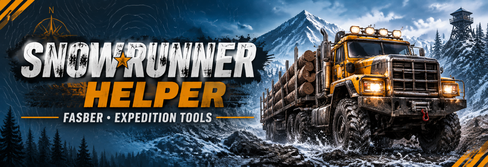

  

  # FASBER
  **Разработка инструментов для SnowRunner | Windows applications**

  *Планируй экспедиции. Подбирай технику. Доставляй грузы.*

  
  
  

---

## 🚛 SnowRunner Helper

Неофициальный настольный помощник для игроков SnowRunner. Проект объединяет справочные данные и инструменты планирования перевозок и крафта в одном приложении для Windows.

| Раздел | Возможности |
| :--- | :--- |
| 📦 Грузы | Справочник материалов, поиск и сортировка |
| 🧮 Калькулятор | Планирование загрузки и подсчёт грузовых слотов |
| 🏭 Крафт | Рецепты, ингредиенты и привязка к картам |
| 🗺️ Маршруты | Ручное планирование остановок и экспедиций |
| 💾 Профили | Чтение поддерживаемых сохранений и отдельные планы загрузки |
| 🖥️ Мини-окно | Быстрый доступ к рецептам поверх игры в оконном режиме |
| 🎨 Интерфейс | Настраиваемые темы, иконки и оформление |

### ⚙️ В разработке

- Расширение каталогов грузовиков, прицепов и оборудования.
- Уточнение характеристик грузов и данных игровых файлов.
- Улучшение интерфейса и интеграции с сохранениями.

### ⬇️ Версии и обновления

Актуальные публикации, если они доступны, находятся в [GitHub Releases](https://github.com/FASBER/SnowRunner-Helper/releases). Инструкции по запуску и сборке — в [репозитории проекта](https://github.com/FASBER/SnowRunner-Helper).

### 🛠️ Технологии

### 💬 Обратная связь

Нашли ошибку или хотите предложить улучшение? [Создайте Issue](https://github.com/FASBER/SnowRunner-Helper/issues).

---

**EN:** SnowRunner Helper is an unofficial Windows companion project for cargo planning, crafting recipes and expedition organization. The project is under active development. Save-file features are limited to supported formats.

  FASBER • EXPEDITION TOOLS 
  Неофициальный фан-проект. Не связан с Saber Interactive или Focus Entertainment.

